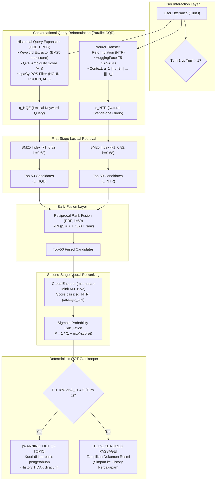

# Multi-Stage Conversational Passage Retrieval for Drug Information (openFDA)

[](https://www.python.org/downloads/)
[](https://pytorch.org/)
[](https://dl.acm.org/doi/10.1145/3446427)
[](https://open.fda.gov/apis/drug/label/)

Implementasi dan replikasi sistem **Conversational Passage Retrieval (CPR)** berbasis metodologi penelitian paper bereputasi tinggi:
> **Sheng-Chieh Lin, Jheng-Hong Yang, and Jimmy Lin.** 2021.  
> *"Multi-Stage Conversational Passage Retrieval: An Approach to Fusing Term Importance Estimation and Neural Query Rewriting."*  
> **ACM Transactions on Information Systems (TOIS)** 39, 4, Article 48 (October 2021), 29 pages. [DOI: 10.1145/3446427](https://doi.org/10.1145/3446427).

Sistem ini dirancang khusus untuk domain informasi obat (*pharma/medical QA*) menggunakan data resmi **openFDA Drug Product Labeling**. Sistem beroperasi murni sebagai arsitektur *Information Retrieval* (IR) multi-tahap tanpa ketergantungan pada model generatif black-box/LLM prompting, sehingga menjamin hasil pencarian selalu berasal dari dokumen resmi regulator (FDA).

---

## 📌 Fitur Utama & Keunggulan

1. **Resolusi Coreference & Omission Tanpa Halusinasi:**  
   Mengatasi ambiguitas percakapan multi-turn (misal: *"What are its side effects?"* atau *"How about children?"*) menggunakan dua modul reformulasi kueri paralel:
   - **Historical Query Expansion (HQE + POS):** Ekstraksi kata kunci topik historis berbasis skor BM25 korpus dan filter part-of-speech (spaCy).
   - **Neural Transfer Reformulation (NTR):** Model *Sequence-to-Sequence* T5 CANARD yang terlatih mereformulasi kalimat elipsis menjadi kueri tunggal yang utuh.
2. **Early Fusion via Reciprocal Rank Fusion (RRF):**  
   Menggabungkan kekuatan leksikal kata kunci eksplisit (HQE) dan kelancaran semantik (NTR) pada tahap first-stage retrieval dengan konstanta $k=60$.
3. **Second-Stage Neural Re-ranking:**  
   Re-ranking presisi tinggi menggunakan model Cross-Encoder (`ms-marco-MiniLM-L-6-v2`) untuk mengurutkan pasase berdasarkan relevansi semantik mendalam.
4. **Gatekeeper Out-of-Topic (OOT) Deterministik:**  
   Mekanisme probabilitas Sigmoid matematis ($P < 18\%$) dan skor leksikal ($A_i$) untuk mendeteksi kueri di luar basis data obat secara akurat dan mencegah *context poisoning*.
5. **CLI Interaktif Siap Pakai:**  
   Antarmuka terminal dengan transparansi pipeline lengkap (skor QPP, hasil reformulasi CQR, probabilitas relevansi, dan kutipan pasase FDA).

---

## 🏗️ Arsitektur & Alur Kerja Sistem



---

## 📁 Struktur Direktori Proyek

```text
Project/
├── data/
│   └── processed/
│       ├── passages.jsonl               # Korpus 5.160 pasase obat terstruktur openFDA (via Git LFS)
│       ├── conversational.json          # 12 Sesi dialog benchmark evaluasi (multi-turn)
│       └── reformulated_queries.json    # Log hasil reformulasi CQR untuk benchmark
├── notebooks/
│   ├── 01_data_preprocessing.ipynb      # Ekstraksi openFDA, chunking seksi medis, & korpus pasase
│   ├── 02_hqe_and_bm25.ipynb            # Indeksasi BM25 & algoritma HQE (+POS spaCy)
│   ├── 03_ntr_rewriter.ipynb            # Evaluasi Neural Transfer Reformulation (T5 CANARD)
│   ├── 04_fusion_and_evaluation.ipynb   # Evaluasi Early Fusion RRF & Cross-Encoder (Metrik Lengkap)
│   └── final_evaluation_results.csv     # Hasil kuantitatif komparasi 6 metode evaluasi
├── interactive_cli.py                   # Aplikasi CLI interaktif terminal multi-turn
├── requirements.txt                     # Daftar dependensi pustaka Python
├── .gitattributes                       # Konfigurasi Git LFS (*.jsonl, *.json)
└── README.md                            # Dokumentasi teknis proyek
```

---

## ⚙️ Setup Lingkungan & Prasyarat

### 1. Prasyarat Sistem
- **Python**: Versi `3.10` atau `3.11` (Direkomendasikan 3.11).
- **Git & Git LFS**: Wajib terpasang untuk mengunduh korpus data besar `passages.jsonl`.
- **Hardware**:
  - **RAM**: Minimal 8 GB (BM25 dan cache model).
  - **GPU**: NVIDIA GPU dengan CUDA direkomendasikan untuk inferensi cepat T5 dan Cross-Encoder (otomatis beralih ke CPU jika tidak tersedia GPU).

### 2. Kloning Repositori & Tarik Data Git LFS
```bash
git clone <URL_REPOSITORI_ANDA>
cd Project

# Pastikan Git LFS aktif dan unduh korpus data
git lfs install
git lfs pull
```

### 3. Buat dan Aktifkan Virtual Environment
- **Windows (PowerShell):**
  ```powershell
  python -m venv venv
  .\venv\Scripts\Activate.ps1
  ```
- **Linux / macOS:**
  ```bash
  python3 -m venv venv
  source venv/bin/activate
  ```

### 4. Instalasi Dependensi & Model spaCy
```bash
pip install --upgrade pip
pip install -r requirements.txt
python -m spacy download en_core_web_sm
```

---

## 📊 Hasil Evaluasi Kuantitatif

Pengujian dilakukan secara objektif pada **12 sesi dialog multi-turn (49 kueri percakapan conversational QA)** dengan pola *omission*, *coreference*, dan *topic shift*.

Berikut adalah hasil evaluasi komparasi 6 metode dari [`final_evaluation_results.csv`](file:///a:/Jurnal%20IR/Project/notebooks/final_evaluation_results.csv):

| No | Konfigurasi Metode | Recall@10 | Recall@50 | MRR | MAP | NDCG@3 |
| :---: | :--- | :---: | :---: | :---: | :---: | :---: |
| 1 | **Raw Query + BM25** *(Baseline)* | 0.3061 | 0.5204 | 0.1970 | 0.1593 | 0.1324 |
| 2 | **Concat Query + BM25** | 0.3639 | 0.6327 | 0.2774 | 0.2125 | 0.1687 |
| 3 | **HQE (+POS) + BM25** *(TOIS 2021)* | 0.5068 | 0.7891 | 0.4104 | 0.3249 | 0.2903 |
| 4 | **NTR (T5 CANARD) + BM25** *(TOIS 2021)* | 0.5850 | **0.8299** | 0.4749 | 0.3714 | 0.3258 |
| 5 | **Early Fusion (RRF) + BM25** *(TOIS 2021)* | 0.5850 | 0.8231 | 0.4486 | 0.3572 | 0.3268 |
| 6 | **Full Multi-Stage (RRF + Cross-Encoder)** | **0.7279** | 0.8231 | **0.7351** | **0.6019** | **0.5995** |

### Analisis Kritis Hasil:
- **Baseline Failure:** Kueri mentah (`Raw Query`) gagal total pada kueri lanjutan karena ambiguitas omission (NDCG@3 hanya `0.1324`).
- **Efektivitas CQR:** Modul HQE dan NTR melipatgandakan *Recall@50* dari `52.04%` menjadi `82.99%`.
- **Dampak Re-ranking:** Integrasi Cross-Encoder pada kandidat gabungan RRF meningkatkan **NDCG@3 sebesar +352%** (dari `0.1324` menjadi `0.5995`) dan **MRR menjadi 0.7351**, membuktikan bahwa pasase jawaban relevan konsisten berada di peringkat pertama (*Top-1*).

---

## 💻 Panduan Pengujian Interaktif (CLI Tutorial)

Skrip interaktif mandiri telah disediakan di [`interactive_cli.py`](file:///a:/Jurnal%20IR/Project/interactive_cli.py) untuk mencoba dialog penelusuran informasi obat secara langsung.

### Menjalankan Program
Pastikan virtual environment telah aktif, lalu jalankan:
```powershell
python interactive_cli.py
```

### Perintah Khusus di Terminal:
- `reset` : Membersihkan memori riwayat dialog (`history = []`) untuk memulai topik obat baru.
- `exit`  : Menutup dan keluar dari program.

---

### 🧪 3 Contoh Skenario Uji Dialog yang Dapat Dicoba

#### Skenario 1: Multi-turn Omission & Coreference (Kasus Panadol & Cetirizine)
Menguji kemampuan sistem mereformulasi kata ganti (*it*, *its*) dan pertanyaan elipsis tanpa menyebutkan nama obat kembali.
```text
User (Turn 1) > tell me about panadol
[Sistem merespons: Pasase indikasi dan peringatan Panadol / Acetaminophen (Prob: 81.69%)]

User (Turn 2) > what is the recommended dosage?
[Sistem mereformulasi via NTR menjadi: "what is the recommended dosage for panadol"]
[Sistem merespons: Pasase DOSAGE & ADMINISTRATION Panadol]

User (Turn 3) > what are its side effects?
[Sistem mereformulasi: "what are side effects of panadol"]
[Sistem merespons: Pasase ADVERSE REACTIONS Panadol]
```

#### Skenario 2: Pergantian Topik Obat (Topic Shift)
Menguji fleksibilitas sistem saat beralih menanyakan obat lain dengan memanfaatkan perintah `reset`.
```text
User (Turn 1) > What is Cetirizine used for?
[Sistem merespons: Pasase indikasi alergi Cetirizine / Zyrtec (Prob: 99.92%)]

User (Turn 2) > What is the adult dosage?
[Sistem merespons: Pasase dosis harian 10 mg Cetirizine]

User (Turn 3) > reset
[INFO: Riwayat percakapan telah dibersihkan. Memulai sesi baru.]

User (Turn 1) > What are the warnings for Ibuprofen?
[Sistem merespons: Pasase peringatan perdarahan lambung Ibuprofen]
```

#### Skenario 3: Uji Gatekeeper Out-of-Topic (OOT)
Menguji kehandalan sistem dalam menolak pertanyaan non-medis atau di luar basis pengetahuan obat openFDA.
```text
# Kasus 3A: Kueri OOT di Turn Pembuka
User (Turn 1) > Siapa presiden Indonesia saat ini?
--------------------------------------------------------------------------------
[DEBUG - CQR & Retrieval Pipeline]
  * QPP Ambiguity Score (A_i)   : 0.00
  * Relevansi Probabilitas (P)  : 0.00%
  * Status Domain               : [OUT OF TOPIC / DI LUAR DOMAIN]
--------------------------------------------------------------------------------
!!!!!!!!!!!!!!!!!!!!!!!!!!!!!!!!!!!!!!!!!!!!!!!!!!!!!!!!!!!!!!!!!!!!!!!!!!!!!!!!
  [WARNING: OUT OF TOPIC / DI LUAR BASIS PENGETAHUAN OBAT]
  Alasan: Skor BM25 awal (0.00 < 4.00) atau probabilitas relevansi (0.00% < 18.00%) terlalu rendah.
!!!!!!!!!!!!!!!!!!!!!!!!!!!!!!!!!!!!!!!!!!!!!!!!!!!!!!!!!!!!!!!!!!!!!!!!!!!!!!!!

# Kasus 3B: Kueri OOT di Tengah Percakapan (Turn > 1)
User (Turn 1) > Tell me about Panadol
User (Turn 2) > How to change a flat bicycle tire?
[Sistem mendeteksi P < 18% -> Menampilkan Warning OOT dan TIDAK memasukkan kueri ban sepeda ke riwayat percakapan]
```

---

## 🔬 Menjalankan Notebook Eksperimen

Jika Anda ingin mereproduksi atau memodifikasi seluruh tahapan riset dari awal:
1. Jalankan Jupyter Lab/Notebook:
   ```bash
   jupyter notebook
   ```
2. Buka folder `Project/notebooks/` dan jalankan berurutan:
   - `01_data_preprocessing.ipynb`: Mengunduh/mengekstrak data openFDA menjadi 5.160 pasase bersih dan menyusun benchmark 12 sesi dialog.
   - `02_hqe_and_bm25.ipynb`: Membangun indeks BM25 dan mengevaluasi modul HQE (+POS).
   - `03_ntr_rewriter.ipynb`: Mengevaluasi modul Neural Query Rewriter T5-CANARD.
   - `04_fusion_and_evaluation.ipynb`: Menjalankan Early Fusion (RRF), Neural Re-ranking, serta mencetak tabel metrik komparasi lengkap.

---

## 📚 Referensi & Sitasi

```bibtex
@article{lin2021multistage,
  author    = {Lin, Sheng-Chieh and Yang, Jheng-Hong and Lin, Jimmy},
  title     = {Multi-Stage Conversational Passage Retrieval: An Approach to Fusing Term Importance Estimation and Neural Query Rewriting},
  year      = {2021},
  issue_date = {October 2021},
  publisher = {Association for Computing Machinery},
  volume    = {39},
  number    = {4},
  issn      = {1046-8188},
  url       = {https://doi.org/10.1145/3446427},
  doi       = {10.1145/3446427},
  journal   = {ACM Trans. Inf. Syst.},
  month     = {aug},
  articleno = {48},
  numpages  = {29}
}
```
